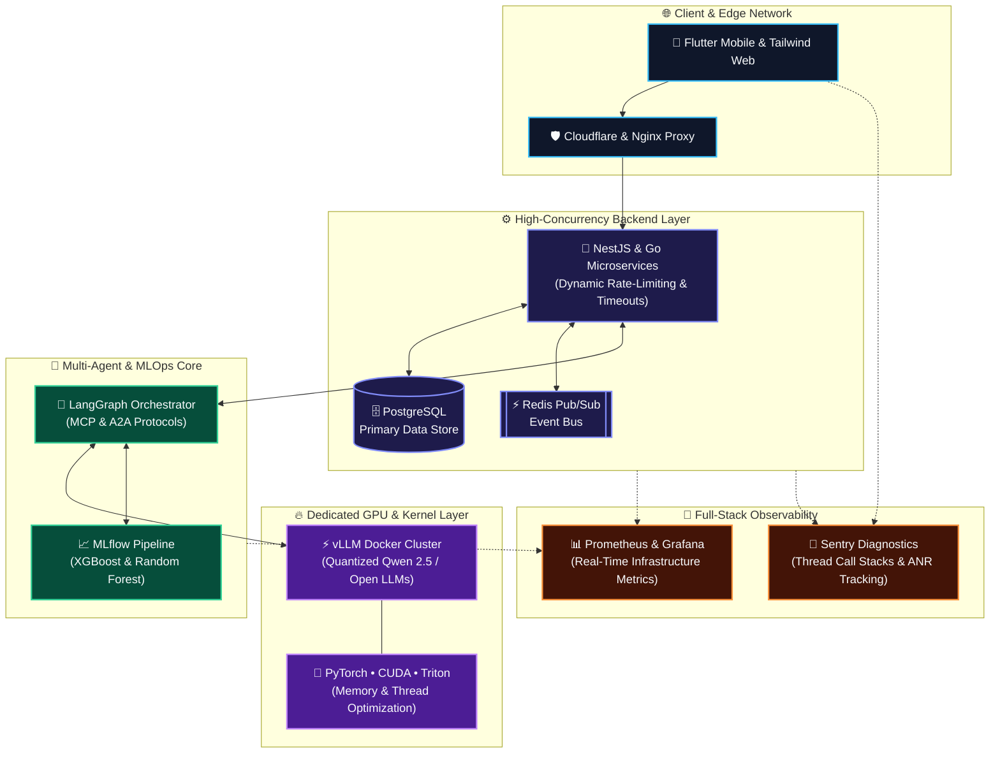

<div align="center">

<!-- 🔥 ANIMATED HERO WAVE BANNER -->


<!-- ⚡ DYNAMIC TYPING ANIMATION -->
<a href="https://github.com/ASIFRAHMANBD">
  
</a>

<br/>

<!-- 🛡️ EXECUTIVE STATUS BADGES -->
<p align="center">
  <a href="https://cloudproductionltd.com"></a>
  
  
</p>

</div>

---

## ⚡ Executive Snapshot

```yaml
engineer:
  name: "Asif Rahman"
  role: "AI Engineer & Distributed Backend Architect"
  core_mission: "Turning heavyweight AI models & complex business logic into low-latency, fault-tolerant production systems."

what_i_avail_to_do:
  ai_engineering:     ["LLM Fine-Tuning", "AWQ/GPTQ/INT4 Quantization", "vLLM GPU Serving", "CUDA & Triton Optimization"]
  agentic_workflows:  ["LangGraph State Machines", "Model Context Protocol (MCP)", "Agent-to-Agent (A2A) Systems"]
  backend_systems:    ["NestJS & Go Microservices", "PostgreSQL & Redis Pub/Sub", "Dynamic Rate-Limiting & Gateways"]
  ops_and_reliability:["MLflow Automated Pipelines", "Prometheus & Grafana Telemetry", "Sentry Crash & ANR Diagnostics"]
```

---

## 🎯 What I Do & Deliver (Bento Capability Grid)

<table>
  <tr>
    <td width="50%" valign="top">
      <h3 align="center">🧠 LLM Ops & Low-Level GPU Compute</h3>
      <p align="center">
        
        
        
        
      </p>
      <p><b>Cut third-party API costs and own your AI infrastructure.</b> I deploy, compress, and optimize open-source models on dedicated GPU servers.</p>
      <ul>
        <li><b>Custom Fine-Tuning:</b> Domain adaptation for models like <b>Qwen 2.5</b> & Llama.</li>
        <li><b>Precision Quantization:</b> Memory-efficient model compression for maximum throughput.</li>
        <li><b>High-Speed Serving:</b> Production Dockerized <b>vLLM</b> clusters with continuous batching.</li>
        <li><b>Kernel Tuning:</b> GPU thread hierarchy & memory optimization via <b>CUDA</b> and <b>Triton</b>.</li>
      </ul>
    </td>
    <td width="50%" valign="top">
      <h3 align="center">🤖 Multi-Agent AI & Automation</h3>
      <p align="center">
        
        
        
        
      </p>
      <p><b>Replace manual workflows with deterministic AI agents.</b> I architect multi-agent systems that reason, call tools, and execute autonomously.</p>
      <ul>
        <li><b>Stateful Orchestration:</b> Cyclic, controllable agent graphs using <b>LangGraph</b>.</li>
        <li><b>Next-Gen Protocols:</b> Standardized tool & agent interoperability via <b>MCP</b> and <b>A2A</b>.</li>
        <li><b>B2B Lead & Data Engines:</b> Automated multi-platform discovery, scraping, and outreach.</li>
        <li><b>Resilient AI Routing:</b> Custom LLM timeouts, fallback handling, and parallel execution.</li>
      </ul>
    </td>
  </tr>
  <tr>
    <td width="50%" valign="top">
      <h3 align="center">🏗️ High-Concurrency Microservices</h3>
      <p align="center">
        
        
        
        
      </p>
      <p><b>Backends engineered for heavy traffic and long-running AI workloads.</b> Modular architectures that scale cleanly without bottlenecks.</p>
      <ul>
        <li><b>Distributed Services:</b> Clean architecture built with <b>NestJS</b>, <b>Go</b>, and <b>Node.js</b>.</li>
        <li><b>Event-Driven Core:</b> Asynchronous messaging with <b>Redis Pub/Sub</b> & optimized <b>PostgreSQL</b>.</li>
        <li><b>Traffic Control:</b> Environment-driven rate-limiting (<code>ThrottlerModule</code>) & reverse proxies.</li>
        <li><b>Cloud & Edge Ready:</b> Deployed on <b>Ubuntu</b> with <b>Docker</b>, <b>PM2</b>, <b>Nginx</b>, and <b>Cloudflare</b>.</li>
      </ul>
    </td>
    <td width="50%" valign="top">
      <h3 align="center">🔭 MLOps, Telemetry & Mobile Stability</h3>
      <p align="center">
        
        
        
        
      </p>
      <p><b>Zero-blindspot production systems.</b> Full visibility into model drift, server health, and client-side application performance.</p>
      <ul>
        <li><b>Automated MLOps:</b> Scheduled training & model evaluation (<b>XGBoost</b>, <b>Random Forest</b>) on <b>MLflow</b>.</li>
        <li><b>Live Observability:</b> Real-time metrics scraping and alerting via <b>Prometheus</b> & <b>Grafana</b>.</li>
        <li><b>Deep Crash Diagnostics:</b> Native thread call-stack & <b>ANR</b> resolution using <b>Sentry</b>.</li>
        <li><b>Cross-Platform Delivery:</b> Production <b>Flutter/Android</b> releases & responsive <b>Tailwind</b> web apps.</li>
      </ul>
    </td>
  </tr>
</table>

---

## 🛠️ Visual Tech Arsenal

<div align="center">

### **Core Languages, Frameworks & Infrastructure**
<p align="center">
  <a href="https://skillicons.dev">
    
  </a>
</p>

### **Specialized AI, GPU & Agentic Stack**
<p align="center">
  
  
  
  
  
  
  
  
</p>

</div>

---

## 🧬 Production System Architecture Blueprint

How I connect **Client Interfaces**, **Microservices**, **Multi-Agent AI**, and **Self-Hosted GPU Clusters** into one cohesive ecosystem:



---

## 💼 Solutions Matrix: How I Add Value to Your Team

| 🎯 Business / Engineering Need | 🛠️ My Technical Solution | 🚀 Production Outcome |
| :--- | :--- | :--- |
| **High LLM API Costs & Latency** | Self-host quantized open-source LLMs (**Qwen 2.5**, Llama) using **vLLM**, **CUDA**, and **Docker** on rented GPU instances. |  |
| **Complex Manual B2B Workflows** | Build autonomous multi-agent pipelines using **LangGraph**, **MCP**, and **A2A** for scraping, reasoning, and outreach. |  |
| **API Timeouts & Traffic Spikes** | Architect **NestJS / Go** microservices with configurable throttling, extended LLM timeouts, and **Redis Pub/Sub**. |  |
| **Blind Deployments & App Crashes** | Integrate **Prometheus + Grafana** server telemetry, **MLflow** tracking, and **Sentry** ANR/thread debugging. |  |

---

## 📂 Featured Engineering Deep-Dives (Click to Expand)

<details open>
<summary><b>🤖 1. Multi-Agent AI Lead Generation & Outreach Engine (LangGraph + NestJS)</b></summary>
<br/>

- **Architectural Blueprint:** Designed a strict multi-agent specification (`MULTI_AGENT_ARCHITECTURE`) powered by **LangGraph**, **Model Context Protocol (MCP)**, and **Agent-to-Agent (A2A)** standards.
- **Production Backend:** Engineered the core backend in **NestJS** (`ai-lead-generator-backend`), implementing environment-driven rate-limiting (`THROTTLE_TTL_MS`, `THROTTLE_LIMIT`) and extended LLM request timeouts (`SEED_LLM_REQUEST_TIMEOUT_MS`) to support heavy parallel scraping and AI inference.
- **Containerized Delivery:** Packaged and versioned deployments via **Docker Compose** for reproducible production rollouts.
</details>

<details>
<summary><b>⚡ 2. Self-Hosted Quantized LLM Serving & Kernel Optimization (vLLM + CUDA + Triton)</b></summary>
<br/>

- **High-Throughput Inference:** Deployed quantized open-source models (such as **Qwen 2.5**) on cloud GPU servers using Dockerized **vLLM** for fast concurrent token generation.
- **Hardware-Level Tuning:** Worked directly with **CUDA** thread hierarchies, GPU memory optimization, **OpenAI Triton**, and **PyTorch** to squeeze maximum compute efficiency out of GPU hardware.
</details>

<details>
<summary><b>🔭 3. Microservices Telemetry, MLOps & Mobile Production Reliability</b></summary>
<br/>

- **MLOps Automation:** Built automated monthly retraining and evaluation pipelines tracked via **MLflow** using **XGBoost** and **Random Forest** algorithms.
- **Infrastructure Monitoring:** Deployed **Prometheus** and **Grafana** monitoring stacks for Dockerized **Go** and **PostgreSQL** microservices behind **Nginx** and **PM2**.
- **Mobile Crash & ANR Resolution:** Managed production Android/Flutter builds on Google Play, utilizing **Sentry** thread call-stack analysis to eliminate ANRs and memory bottlenecks.
</details>

---

<div align="center">

## 🤝 Let's Architect Your Next System

Whether you need to **deploy self-hosted LLMs**, **orchestrate multi-agent AI workflows**, or **scale high-concurrency backend microservices**, let's connect and build it right.

<p align="center">
  <a href="https://github.com/ASIFRAHMANBD"></a>
  <a href="https://cloudproductionltd.com"></a>
  <a href="https://linkedin.com/in/"></a>
  <a href="mailto:your-email@example.com"></a>
</p>

<!-- 🌊 ANIMATED FOOTER WAVE -->


</div>
